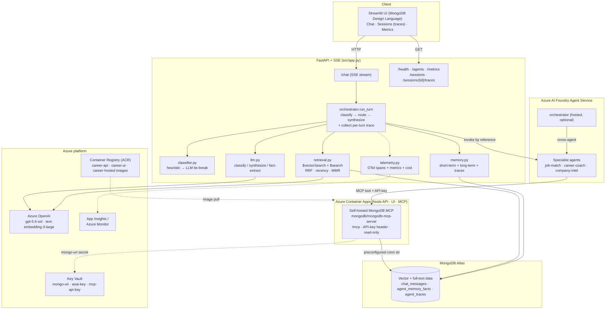
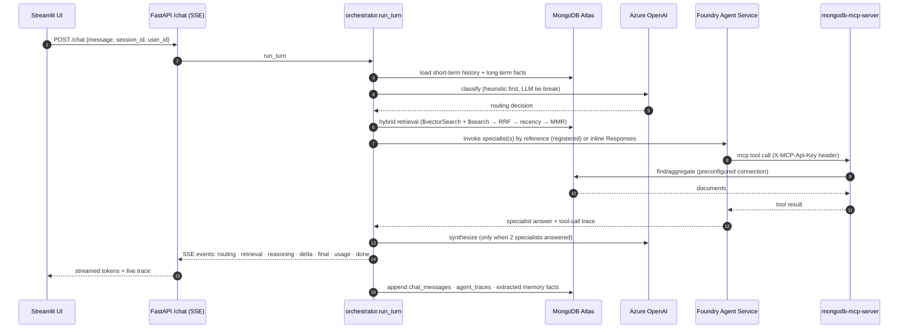
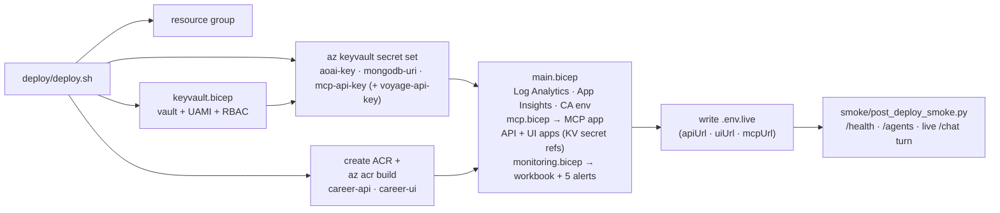

# MongoDB × Azure AI Foundry — Multi-Agent Career Assistant

> This project is an **Azure / Microsoft** stack based multi-agent "Career Assistant"
> with **MongoDB Atlas** at its core.  

It runs a **MongoDB-centric** "Career Assistant" scenario on the following stack:

| Component | This demo |
|---|---|
| Agent runtime | **Azure AI Foundry Agent Service** — all four agents run as **separate hosted agents** (one managed-compute container each) |
| Orchestration | The `orchestrator` hosted agent classifies and invokes the specialist hosted agents **by reference** (cross-agent), then synthesizes |
| Grounding | **MongoDB-only** — every agent answers strictly from data retrieved via the MongoDB MCP server; no general-knowledge fallback |
| Models | **Azure OpenAI / Foundry** chat (`gpt-5.6-sol`); **pluggable embeddings** — `foundry` (Azure OpenAI, default), `voyage` (Voyage AI direct), or `atlas_auto` (Atlas Automated Embedding) via `EMBEDDING_PROVIDER` (see specs/002) |
| Tool gateway | Foundry **MCP tool** → **self-hosted `mongodb/mongodb-mcp-server`** on **Azure Container Apps** (Streamable HTTP `/mcp`, API-key header) |
| Memory | **MongoDB** short-term (`chat_messages`) + long-term facts (`agent_memory_facts`) + per-turn agent traces (`agent_traces`) |
| API | **FastAPI** + SSE |
| UI | **Streamlit**, **MongoDB Design Language** theme — Chat + **Sessions** (per-turn agent traces) + **Metrics** dashboard, with a live Usage & Cost sidebar |
| Observability | **Azure Monitor + OpenTelemetry** (traces/metrics), in-app `/metrics` + Streamlit dashboard + estimated USD cost |
| Secrets | **Azure Key Vault** + user-assigned managed identity (no secrets in env/Bicep) |
| Testing | Layered **pytest** — unit (offline) / integration / e2e / post-deploy smoke |
| Infra-as-code | **Bicep** |

Four agents ship: `orchestrator` (router) + three routable specialists `job-match`, `career-coach`, `company-intel`.

---

## Prerequisites (must exist before running)

This demo assumes **you** have already provisioned:

1. **Azure AI Foundry project** — `azure-multiagent-proj`. Copy its **project endpoint**.
2. **Chat model deployment** — `gpt-5.6-sol` (used by all specialists + classifier/synthesizer/fact-extractor).
3. **Embedding provider** — default `foundry`: an Azure OpenAI embedding deployment
   (`text-embedding-3-large` → **3072-dim**). Alternatives via `EMBEDDING_PROVIDER`:
   `voyage` (direct Voyage AI API — needs `VOYAGE_API_KEY`) or `atlas_auto` (Atlas Automated
   Embedding — no embedding credentials; Atlas embeds at index & query time). See
   [specs/002](specs/002-configurable-embedding-provider/spec.md). Switching providers
   requires `python -m db_seeding.seed_all --drop --recreate-indexes` + recalibrating
   `RETRIEVAL_MIN_SCORE` (`python -m scripts.calibrate_retrieval_floor`).
4. **MongoDB Atlas** — cluster `FabricCluster`, database `multi-agent`, on a tier that supports **Atlas Vector Search** (M10+ or Flex). Have the connection string ready.
5. **Azure CLI** logged in (`az login`) with access to the tenant/subscription — used for `DefaultAzureCredential`.

> **MongoDB MCP server — self-hosted, nothing to pre-provision.** `deploy/deploy.sh` deploys the
> official `mongodb/mongodb-mcp-server` image as an Azure Container App (`mcp.bicep`). Its container
> holds the MongoDB connection string (from Key Vault), so the agents never handle DB credentials —
> they call the MCP over Streamable HTTP at `<fqdn>/mcp` and (for external ingress) send a shared
> **API-key header**. For **local dev**, run the MCP in Docker and point `MONGODB_MCP_URL` at it:
> ```bash
> docker run --rm -p 3001:3000 \
>   -e MDB_MCP_CONNECTION_STRING="$MONGODB_URI" \
>   -e MDB_MCP_TRANSPORT=http -e MDB_MCP_HTTP_HOST=0.0.0.0 -e MDB_MCP_HTTP_PORT=3000 \
>   -e MDB_MCP_READ_ONLY=true \
>   -e MDB_MCP_DANGEROUS_HOST_BINDING=true \
>   mongodb/mongodb-mcp-server:latest
> # then set MONGODB_MCP_URL=http://localhost:3001/mcp in .env
> ```
>
> > Notes (from the specs/006 QA cycle):
> > - **Port**: use host port **3001** for the local MCP — the API defaults to `PORT=3000` and
> >   would collide with a `-p 3000:3000` mapping.
> > - **`MDB_MCP_DANGEROUS_HOST_BINDING=true`** is required by current `mongodb-mcp-server`
> >   images (v3.x): the server refuses to bind `0.0.0.0` without it. Safe here — Docker's port
> >   mapping is what actually exposes it, to localhost only.
> > - **Registered Foundry agents cannot reach a localhost MCP** — Foundry runs in Azure and its
> >   outbound SSRF protection blocks loopback/private URLs. For local runs either use
> >   `SPECIALIST_MODE=inline`, or point `MONGODB_MCP_URL` at the **deployed cloud MCP**
> >   (from `.env.live`) with `MCP_API_KEY` set **and** a Foundry project connection holding the
> >   API-key header (`MCP_CONNECTION_ID`, e.g. a CustomKeys connection named `mongodb-mcp`) —
> >   Foundry rejects raw auth headers on registered MCP tools.

---

## Quick start (local)

```bash
cd multi-agent-using-mongodb-for-hyperscaler
python -m venv .venv && source .venv/bin/activate
pip install -r requirements.txt -r requirements-foundry.txt

cp .env.sample .env      # then fill in the blanks (project endpoint, Atlas URI, OpenAI key)
az login                 # DefaultAzureCredential picks this up

# 1) Seed Atlas + create vector/search indexes + generate embeddings
python -m db_seeding.seed_all

# 2) Register the specialists on the Foundry Agent Service (idempotent)
python -m scripts.provision_agents verify   # confirm the resource accepts agent ops
python -m scripts.provision_agents sync      # create/update the routable specialists
# NOTE: sync hashes the agent INSTRUCTIONS only — after changing MONGODB_MCP_URL / MCP_API_KEY /
# MCP_CONNECTION_ID, run `python -m scripts.provision_agents sync --force` to push the new tool
# config (known limitation D7, specs/006).

# 3) Run the API (FastAPI + SSE) and the UI
uvicorn src.app:app --reload --port ${PORT:-3000}
streamlit run ui/streamlit_app.py     # in a second terminal
```

> The app defaults to `SPECIALIST_MODE=registered-or-inline`: it invokes the registered
> Foundry agents, falling back to inline Responses only if the Foundry stack/resource is
> unavailable. See **[docs/foundry-agents.md](docs/foundry-agents.md)**.

Open the Streamlit URL and try:
> *"Find jobs matching my CV and tell me about those companies."*

---

## Architecture



### A chat turn, end to end



### Orchestration
A custom classifier/router (`classifier.py`) selects the specialist(s) for each turn and invokes
them on the Azure AI Foundry Agent Service. Deterministic and fast. Small talk / capability
questions are answered directly by the orchestrator; substantive turns fan out to one or two
specialists. When two specialists answer, a synthesizer (`gpt-5.6-sol`) merges their replies into
one. Every agent answers **strictly from MongoDB** — a grounding contract injected by
`config_loader.build_agent_instructions` forbids general-knowledge fallback.

### Specialist execution (`SPECIALIST_MODE`)
- **`registered-or-inline`** *(default)* — invoke the registered Foundry prompt agents; fall back to inline Responses if the Foundry resource/SDK is unavailable.
- **`registered`** — strict: only the registered Foundry agents (error if unavailable).
- **`inline`** — always run inline via the raw Responses API (no Foundry registration).

### Foundry consumption topologies
The same pipeline can be consumed four ways off one source of truth (`config/agents/*.agent.md`) —
see **[docs/foundry-agents.md](docs/foundry-agents.md)**:

1. **Inline** — specialists run in-process inside the FastAPI app (the default fallback).
2. **Prompt agents** — the 3 specialists are registered as Foundry prompt agents (`scripts.provision_agents sync`).
3. **Whole-solution hosted agent** — the entire orchestrator runs as one managed-compute container (`deploy/provision_hosted.sh`).
4. **Four separate hosted agents** — every agent (incl. `orchestrator`) is its own managed-compute container; the orchestrator invokes the specialist containers cross-agent by reference (`deploy/provision_agents_hosted.sh`).

### CV parsing (why text-only embeddings are enough)
CV parsing is a **separate** extract-and-structure step (text extractor + `gpt-5.6-sol` pulls skills/experience). Matching then embeds the parsed **text** against job **text** via `text-embedding-3-large`. Multimodal (Voyage) would only be needed to embed *scanned/image* CVs directly — out of scope.

---

## UI (Streamlit)

The Streamlit app (`streamlit run ui/streamlit_app.py`) is themed with the **MongoDB Design Language**
(LeafyGreen palette, dark canvas; `ui/theme.py`). Three pages in the left navbar:

1. **Career Assistant** — the chat, with a live **agent trace** (routing → tool calls → synthesis)
   and a **Usage & Cost** sidebar (six KPIs — see [Observability](#observability)).
2. **Sessions** (`ui/pages/2_Sessions.py`) — browse past conversations (turns, tokens, cost, last
   activity). Click a session to open its per-turn **agent traces**, each with five tabs:
   - **Reasoning flow** — the step-by-step routing/retrieval/tool/synthesis timeline
   - **Tokens & cost** — prompt/completion/total tokens, estimated USD, LLM calls, latency
   - **MCP tool calls** — each MongoDB Atlas MCP call (agent, tool, id)
   - **Memory context** — long-term facts + short-term history + hybrid-retrieval grounding pulled from Atlas
   - **Raw events (JSON)** — every SSE event exactly as streamed
3. **Metrics** (`ui/pages/3_Metrics.py`) — the observability dashboard.

Traces are collected per turn by the orchestrator and persisted to the MongoDB `agent_traces`
collection; the Sessions page reads them via `GET /sessions` and `GET /sessions/{id}/traces`.

> Only turns handled **after** this feature shipped have traces (older turns predate the
> `agent_traces` collection). Traces have no TTL — prune them if the collection grows large.

---

## Deploy to Azure (optional)

```bash
cd deploy
./deploy.sh <resource-group> <location>   # e.g. ./deploy.sh mdb-maf-demo eastus
```



Provisions (via `main.bicep` + `keyvault.bicep` + `mcp.bicep` + `monitoring.bicep`): a Log Analytics
workspace, Application Insights, a Container Apps environment, ACR, Key Vault + a user-assigned managed
identity, the **self-hosted MongoDB MCP Container App**, and the API + UI
Container Apps, plus the Azure Monitor alerts/workbook. There is **no embedding Function App**
(specs/002) — the API calls the configured embedding provider directly; for `EMBEDDING_PROVIDER=voyage`
set `VOYAGE_API_KEY` in `.env` and it is pushed to Key Vault like the other secrets. `deploy.sh` generates the MCP API key, pushes
secrets into Key Vault, builds/pushes images, deploys, then runs the post-deploy smoke test and writes
endpoints to `.env.live`. The MongoDB Atlas cluster and the Foundry project/model deployments are
**reused** (not redeployed).

Optionally run the agents as Foundry hosted agents instead of inline —
`./deploy/provision_hosted.sh <rg>` (whole solution in one container) or
`./deploy/provision_agents_hosted.sh <rg>` (four separate containers). See
**[docs/foundry-agents.md](docs/foundry-agents.md)**.

---

## Observability

Traces and metrics flow to **Application Insights / Azure Monitor** via the Azure Monitor
OpenTelemetry distro (`src/telemetry.py`). Spans cover `chat.turn` → classify → `specialist.<name>`
→ synthesize, plus auto-instrumented FastAPI/httpx/pymongo. Custom metrics: `chat.turns`,
`chat.errors`, `chat.latency_ms`, `specialist.invocations`, `tool.calls`, `llm.tokens`.

`monitoring.bicep` provisions an Ops **workbook** and 5 alerts (API 5xx, p95 latency, container
restarts, chat-error rate, token-budget). Enable export by setting
`APPLICATIONINSIGHTS_CONNECTION_STRING` (set automatically in the cloud stack); everything no-ops
cleanly when it's unset.

Even without App Insights, an always-on in-memory store powers `GET /metrics` and the Streamlit
**Metrics** page (`ui/pages/3_Metrics.py`): turn count, p50/p95/avg latency, token totals,
specialist/tool mix, and estimated USD cost. The chat page also shows a live **Usage & Cost**
sidebar with six headline KPIs (updated on page refresh):

1. Total tokens consumed
2. Total cost (USD)
3. Avg latency
4. Avg tokens per request
5. Avg tool calls per request
6. Avg LLM calls per request

Cost is estimated from token counts × configurable per-1M pricing (`PRICE_INPUT_PER_1M` /
`PRICE_OUTPUT_PER_1M`, defaulting to gpt-4o list pricing).

> Metrics are stored **in-process** per API replica/revision (they reset on restart and aren't
> shared across replicas). App Insights is the durable, cross-replica view.

---

## Testing

Layered `pytest` (config in `pytest.ini`, dev deps in `requirements-dev.txt`):

```bash
pip install -r requirements-dev.txt
pytest                                   # default: unit only, offline, no credentials
RUN_INTEGRATION=1 pytest -m integration  # real Mongo + Azure OpenAI
RUN_E2E=1 API_URL=<url> pytest -m e2e     # SSE contract against a running API
```

- **unit** (`tests/unit/`) — offline, always run: classifier, orchestrator, retrieval math, memory, mcp_client, settings, telemetry.
  ⚠️ The unit suite currently reads your local `.env` (defect D3, specs/006) — if your `.env`
  deviates from defaults, either run with defaults overridden
  (`MONGODB_ALLOW_WRITE=false SHORT_TERM_MEMORY_BACKEND=mongo EMBEDDING_PROVIDER=foundry pytest -m unit`)
  or expect env-dependent failures.
- **integration** (`tests/integration/`) — gated by `RUN_INTEGRATION=1` (hits live backends).
  Requires a calibrated `RETRIEVAL_MIN_SCORE` for the active `EMBEDDING_PROVIDER`
  (`python -m scripts.calibrate_retrieval_floor`), or the off-corpus grounding test fails.
- **e2e** (`tests/e2e/`) — gated by `RUN_E2E=1` + `API_URL` (SSE stream against a running API).
- **smoke** (`smoke/post_deploy_smoke.py`) — run automatically by `deploy.sh`; checks `/health`, `/agents`, and a live `/chat` turn.

### QA / UAT

A full QA & UAT cycle — 78 scenarios across environment validation, offline QA, live integration,
API/SSE contract, functional agent behaviour, negative/edge cases, UI UAT, cloud deployment smoke,
and observability — was executed on 2026-09-22 against both the local setup and the deployed Azure
Container Apps stack. **Result: PASS WITH DEFECTS** (61 pass / 7 fail / 1 blocked / 1 N/A).
Full input/expected/actual results, evidence, and the defect log:
**[specs/006-qa-uat-plan/qa-uat-report.md](specs/006-qa-uat-plan/qa-uat-report.md)**.

Open defects worth knowing before demoing (details + reproduction in the report):

| ID | Severity | Summary |
|---|---|---|
| D10 | Major | Atlas outage truncates the `/chat` SSE stream (no `error`/`final`/`done` sent) |
| D9 | Major | In-session conversational recall can fail when a follow-up is misrouted to a grounded specialist |
| D8 | Minor | Small talk / capability questions route to a specialist instead of a direct orchestrator reply |
| D7 | Major | `provision_agents sync` doesn't detect MCP tool-config changes (use `--force`) |
| D3 | Major | Unit suite is not isolated from the developer's `.env` |

---

## Repo layout

```
config/agents/    orchestrator|job-match|career-coach|company-intel .agent.md
config/skills/    SKILL.md per specialist
src/              app.py, orchestrator.py, classifier.py, foundry_agents.py, foundry_registry.py,
                  hosted_agent.py, agent_host.py, memory/ (package: facade + mongo/foundry backends),
                  retrieval.py, embeddings.py (provider facade: foundry|voyage|atlas_auto),
                  mcp_client.py, llm.py, telemetry.py, config_loader.py, settings.py
scripts/          provision_agents.py, provision_hosted.py
db_seeding/       seed_all.py + provider-aware Atlas index definitions + sample data
specs/            spec-driven development — approved specs + plans before code (see specs/README.md)
ui/               streamlit_app.py (chat + Usage&Cost sidebar) · theme.py (MongoDB Design Language)
                  pages/2_Sessions.py (sessions + agent traces) · pages/3_Metrics.py (dashboard)
tests/            unit/ (offline) · integration/ · e2e/ · conftest.py    smoke/ post-deploy check
deploy/           main.bicep, keyvault.bicep, mcp.bicep, monitoring.bicep, Dockerfile.*, deploy.sh,
                  destroy.sh, provision_hosted.sh, provision_agents_hosted.sh
docs/             service-map.md, foundry-agents.md, mcp-server.md, memory.md, secrets.md,
                  HARDENING-PLAN.md, Azure-Foundry-MultiAgent-Port-PLAN.md (historical)
```

---

## Documentation

| Doc | Contents |
|---|---|
| [docs/service-map.md](docs/service-map.md) | What service is used where and how — per-service files, APIs, env vars |
| [docs/foundry-agents.md](docs/foundry-agents.md) | The three Foundry-native consumption options (prompt agents, hosted agent, four hosted agents) |
| [docs/mcp-server.md](docs/mcp-server.md) | Self-hosted MongoDB MCP server: auth header, safety defaults, local dev, troubleshooting |
| [docs/memory.md](docs/memory.md) | Memory layers and the `mongo` vs `foundry` short-term backend (specs/001) |
| [docs/secrets.md](docs/secrets.md) | Secret inventory, Key Vault model, rotation runbook |
| [docs/HARDENING-PLAN.md](docs/HARDENING-PLAN.md) | Production hardening: what's done, what's open |
| [docs/Azure-Foundry-MultiAgent-Port-PLAN.md](docs/Azure-Foundry-MultiAgent-Port-PLAN.md) | Historical: the original AWS→Azure port plan (implemented) |
| [specs/README.md](specs/README.md) | Spec-driven development workflow + index of all specs |

---

## Cleanup

Tear down everything `deploy.sh` created:

```bash
cd deploy
./destroy.sh <resource-group>            # interactive confirm; deletes the whole RG
./destroy.sh <resource-group> --yes      # no prompt
./destroy.sh <resource-group> --keep-rg  # delete only stack resources, keep the RG
```

The self-hosted **MongoDB MCP Container App is stack-owned** and is torn down with the rest.
Preserved by default (prerequisites, not stack-owned): the **Foundry project/model deployments** and
**MongoDB Atlas** data. Opt-in flags: `--purge-keyvault`, `--purge-foundry-agents`, `--drop-atlas`.
See `deploy/destroy.sh --help` header for details.

---

## Secrets

Secrets (Azure OpenAI key, Mongo URI, MCP API key, optional Voyage key) are stored in
**Azure Key Vault** and read by the API + MCP Container Apps via a **user-assigned managed
identity** (read-only `Key Vault Secrets User`) — no secret values land in container env or
Bicep parameters. `deploy.sh` pushes the values
from your local `.env` (and the generated MCP API key) into Key Vault. See
**[docs/secrets.md](docs/secrets.md)** for the rotation runbook.

> Keep `.env` / `.env.live` untracked (already in `.gitignore`); commit only `.env.sample`.

---

## Security

Moving the MongoDB MCP server in-house (self-hosted on Azure Container Apps) changes the threat
model. This is a **demo**, so several controls are intentionally relaxed — they're listed here as
**known vulnerabilities** with the recommended production fix. Do not run this as-is in production.

### Self-hosted MongoDB MCP

| # | Vulnerability | Current state | Risk | Production fix |
|---|---|---|---|---|
| S1 | **MCP endpoint is internet-facing** | `mcp.bicep` uses `external: true` ingress so out-of-environment Foundry hosted agents can reach it | The `/mcp` endpoint is publicly routable | Use **internal ingress** + Private Endpoint/VNet when Foundry agents run in-VNet; or front it with a gateway/WAF and IP allow-list |
| S2 | **Shared static API key (single factor)** | A single `MCP_API_KEY` header (`X-MCP-Api-Key`) gates all callers; `require_approval="never"` auto-approves tool calls | Key leak = full read access to the MCP; no per-caller identity, no rotation automation | Prefer **Entra ID / managed-identity** auth to the MCP; rotate the key regularly; scope keys per caller |
| S3 | **API key composed into a Container App secret string** | `mcp.bicep` builds `MDB_MCP_HTTP_HEADERS` JSON inline from the `@secure()` param (Bicep `use-secure-value` warning) | Value is stored as a CA secret (not plaintext env), but the composed string isn't a first-class KV reference | Store the full headers JSON as its own **Key Vault** secret and reference it |
| S4 | **MongoDB connection string in the MCP container** | The MCP holds `MDB_MCP_CONNECTION_STRING` (from KV) with cluster credentials | Container compromise exposes DB credentials | Use a **least-privilege, read-only** Atlas DB user scoped to `multi-agent`; rotate; Private Link to Atlas |
| S5 | **No mTLS between agents and MCP** | Plain HTTPS + header key | A misconfigured egress could talk to a spoofed endpoint | Pin the MCP FQDN; consider mTLS / private networking |

Mitigations already in place: the MCP runs **read-only** (`MDB_MCP_READ_ONLY=true`; write tools are
never exposed unless `MONGODB_ALLOW_WRITE=true`), **server-side JS is disabled**
(`MDB_MCP_DISABLE_SERVER_SIDE_JS=true`, blocks `$where`/`$function` injection), and connections are
**session-scoped** (`MDB_MCP_CONNECTION_SCOPE=session`) so concurrent HTTP clients stay isolated.

### Application (API / UI)

| # | Vulnerability | Current state | Risk | Production fix |
|---|---|---|---|---|
| S6 | **No authn/authz on the API** | `POST /chat` and all endpoints are open | Anyone who reaches the API can drive the agents / read memory | Add **Entra ID JWT** auth (see HARDENING-PLAN) + per-user authorization |
| S7 | **CORS `allow_origins=["*"]`** | `src/app.py` allows any origin | CSRF-style abuse from any site | Restrict to the UI origin(s) |
| S8 | **API + UI have public ingress** | `main.bicep` `external: true` for both | Public attack surface | Internal ingress + gateway/Front Door with auth |
| S9 | **Prompt-injection via retrieved/tool data** | Agents are grounded on MongoDB + MCP tool output | Malicious documents could steer the model | Treat tool/DB output as untrusted; keep `allowed_tools` allow-listing (already on); add output filtering |
| S10 | **Secrets in local `.env`** | Real keys live in an untracked `.env` for local runs | On-disk credential exposure | Rotate anything shared; use Key Vault everywhere; never commit `.env` |

### Platform / infra

| # | Vulnerability | Current state | Production fix |
|---|---|---|---|
| S11 | **Key Vault public network access** | `keyvault.bicep` `publicNetworkAccess: 'Enabled'` | Switch to **Private Endpoint** + firewall |
| S12 | **ACR admin user enabled** | `deploy.sh` creates ACR with `--admin-enabled true`; the API pulls with the admin password secret | Disable admin user; pull via **managed identity** (`AcrPull`) only |
| S13 | **No rate limiting** | None on the API or MCP | Add rate limiting / quotas at the gateway |
| S14 | **No egress restrictions** | Containers have open egress | Lock egress to Atlas + Azure OpenAI + MCP only |

See **[docs/HARDENING-PLAN.md](docs/HARDENING-PLAN.md)** for the sequenced remediation plan.

---

## Production hardening

Done: **Key Vault** secret hardening · **destroy** tooling · **App Insights / Azure Monitor**
observability (traces, metrics, workbook, 5 alerts) · **layered testing** (unit/integration/e2e/smoke).
Planned (see **[docs/HARDENING-PLAN.md](docs/HARDENING-PLAN.md)**): Private Endpoint / VNET to Atlas ·
Entra ID JWT auth · rate limiting · CI/CD.
