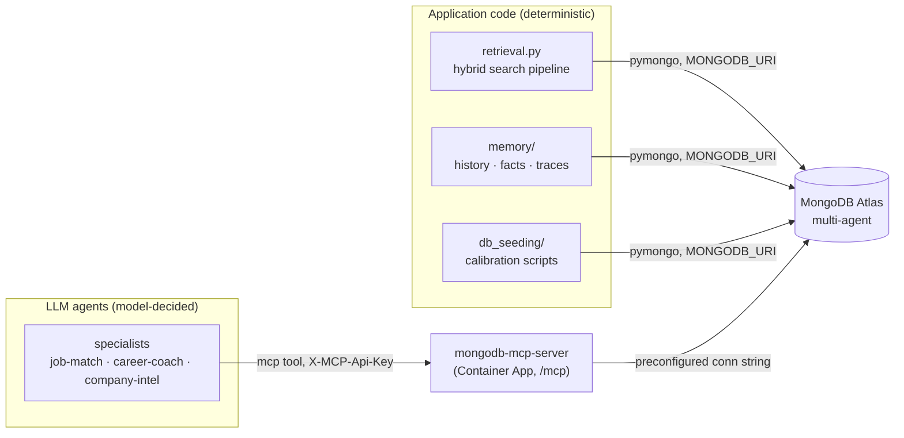

# Data access: why Atlas is exposed through two interfaces

The system talks to MongoDB Atlas through **two deliberate paths**:

| Path | Transport | Who uses it |
|---|---|---|
| **Direct driver** | `pymongo` (`MONGODB_URI`) | Application code: retrieval, memory, traces, seeding |
| **MCP server** | Streamable HTTP `/mcp` via the self-hosted `mongodb-mcp-server` | LLM agents' mid-turn tool calls (`find`, `aggregate`, `count`, …) |

This is not accidental duplication. Each path exists for things the other cannot do.

## Why memory and retrieval use pymongo directly

1. **Retrieval needs math MCP can't do.** The pipeline in `src/retrieval.py` runs
   `$vectorSearch` + `$search` (BM25), then fuses the two ranked lists with **RRF (k=60)**,
   applies **recency decay** (90-day half-life), diversifies with **MMR (λ=0.7)**, and cuts
   below a calibrated relevance floor. That scoring happens in Python over raw result sets —
   through MCP, results come back as text in the model's context and there is no way to fuse
   lists or compare embedding vectors.
2. **Latency and determinism.** History loads, fact writes, and trace appends happen on
   *every* turn. Through MCP each would be agent → Foundry runtime → HTTPS → MCP → Atlas and
   back, with the model deciding *whether* to call the tool. Session history must not be a
   judgment call; with pymongo it either happens or raises.
3. **Token cost.** MCP tool results enter the model's context as text. Twenty-turn chat
   histories and full `agent_traces` rows are large — piping them through the model burns
   input tokens on data the model never needs to see. pymongo moves them off-context.
4. **Write correctness.** `agent_memory_facts` is upsert-deduped via a unique index on
   `(user_id, fact)`; traces and sessions must be written reliably. An LLM tool call can be
   skipped, retried, or malformed — unacceptable for audit and memory writes.
5. **Operational simplicity.** One credential (`MONGODB_URI`), no extra hop, fully testable
   offline (`mongomock` in the unit suite).

## Why agents still need the MCP path

Registered and hosted Foundry agents execute **server-side** — the only tool interfaces the
runtime supports are MCP (or OpenAPI) tools. There is no way to attach in-process Python
functions to them. So when the *model* decides mid-turn to "look up jobs matching X" or
"aggregate salaries for Y", the MCP server is the only door into Atlas.

The MCP container also owns the connection string (from Key Vault), which means **agents
never handle DB credentials** — a security property, not just plumbing.

## The decision rule

| Who decides the query? | Path |
|---|---|
| **Application code** — load history, save trace, run the tuned retrieval pipeline | pymongo, direct |
| **The LLM, mid-turn** — ad-hoc exploration of collections | MCP tool |

## Accepted trade-off

The two paths can return different results for the same question: the app's pymongo
retrieval applies RRF/recency/MMR and the relevance floor, while an agent's MCP query is a
single `find`/`aggregate` with no fusion. That is accepted — the MCP path is for ad-hoc,
model-driven exploration; the pymongo path is for the curated grounding block. Keep this in
mind when debugging "the agent saw different data than the retrieval trace."

## Related

- [mcp-server.md](mcp-server.md) — MCP deployment, auth header, safety defaults
- [memory.md](memory.md) — memory layers and collections
- [service-map.md](service-map.md) — per-service usage map (sections 3 & 4)
- specs/001 (memory), specs/002 (embedding providers)
