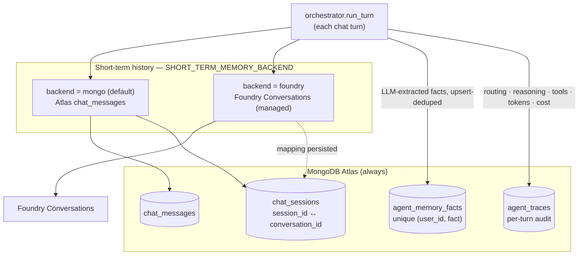

# Memory architecture

Implements [specs/001](../specs/001-foundry-short-term-memory/spec.md)
([plan](../specs/001-foundry-short-term-memory/plan.md)).

## Layers



| Layer | Store | Backend / collection |
|---|---|---|
| Short-term (session history) | selectable | `mongo` → Atlas `chat_messages` (default) · `foundry` → Foundry Conversations |
| Long-term user facts | MongoDB Atlas | `agent_memory_facts` (LLM-extracted, upsert-deduped per user) |
| Per-turn audit traces | MongoDB Atlas | `agent_traces` |
| Session metadata (listing) | MongoDB Atlas | `chat_sessions` — written by **both** short-term backends |

## Choosing the short-term backend

Set `SHORT_TERM_MEMORY_BACKEND` (default `mongo`):

```
SHORT_TERM_MEMORY_BACKEND=mongo     # Atlas chat_messages (original behavior)
SHORT_TERM_MEMORY_BACKEND=foundry   # managed Foundry Conversations
```

The `foundry` backend requires the optional Foundry stack
(`pip install -r requirements-foundry.txt`) and `AZURE_AI_PROJECT_ENDPOINT`, and
authenticates with `DefaultAzureCredential` (`az login` locally, managed identity in
Azure). One Foundry conversation is created lazily per chat session; the
`session_id → conversation_id` mapping is persisted in `chat_sessions`, so history
survives API restarts.

Notes:

- **History is injected as text** (`history_as_text`, last 20 turns) regardless of
  backend — conversations are the persistence layer, not (yet) the model-input
  mechanism. See spec Q2.
- **Hard split between backends** (spec Q4): switching backends starts history fresh.
  Sessions from either backend remain listed in the UI via `chat_sessions`/`agent_traces`.
- **No conversation cleanup in v1** (spec Q1): abandoned Foundry conversations are left
  to platform retention; `chat_sessions.conversation_id` enables a future cleanup job.
- **Failure policy**: history read/append failures degrade to a no-context answer and a
  log warning — they never fail the chat turn.
- The legacy `chat_messages` collection is retained read-only for pre-existing sessions;
  there is no data migration by design.

## Tests

- Offline: `pytest -m unit` (`tests/unit/test_memory*.py`; Foundry client faked, Atlas
  via mongomock).
- Live: `RUN_INTEGRATION=1 pytest -m integration tests/integration/test_memory_foundry_live.py`
  (real Atlas + Foundry; requires the Foundry stack and `az login`).
