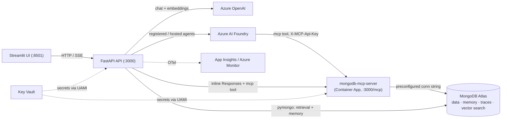

# Service Map — what service is used where, and how

Multi-agent "Career Assistant" (Azure AI Foundry port of the MongoDB Bedrock AgentCore
reference architecture). Each section lists the files where a service is used, how it is
used, and the env vars that configure it.

## Architecture at a glance

## 1. Azure OpenAI — chat models + embeddings

- **Files**: `src/llm.py`, `src/embeddings.py`, `src/foundry_agents.py`, `src/classifier.py`
- **How**: `openai` SDK (`AzureOpenAI` / plain `OpenAI` against `{base}/openai/v1`) for
  Chat Completions and the streaming Responses API (`reasoning={"summary": "auto"}`);
  embeddings via raw REST (`urllib`) to `/openai/deployments/{model}/embeddings`.
  Models: chat = `gpt-5.6-sol` (specialists and classifier/synthesizer), embeddings =
  `text-embedding-3-large` (3072 dims). Reasoning-model quirks handled by optimistic
  param-strip retry (drops `temperature`/`reasoning_effort` on 400). Auth: API key
  preferred, keyless `DefaultAzureCredential` fallback.
- **Env**: `AZURE_OPENAI_ENDPOINT`, `AZURE_OPENAI_API_KEY`, `AZURE_OPENAI_API_VERSION`,
  `AZURE_AI_MODEL_DEPLOYMENT_NAME`, `CLASSIFIER_MODEL_DEPLOYMENT`, `EMBEDDING_MODEL`,
  `EMBEDDING_DIMENSIONS`, `PRICE_INPUT_PER_1M` / `PRICE_OUTPUT_PER_1M` (cost estimate only).

## 2. Azure AI Foundry — agent hosting & registry

- **Files**: `src/foundry_registry.py` (only module using `azure-ai-projects`),
  `src/foundry_agents.py`, `src/hosted_agent.py`, `src/agent_host.py`,
  `src/memory/_foundry.py`, `scripts/provision_agents.py`, `scripts/provision_hosted.py`
- **How**: Three Responses-based consumption topologies (new Agent Service, no classic
  threads):
  1. **Prompt agents** — `agents.create_version(PromptAgentDefinition(model, instructions,
     tools=[MCPTool...]))`; idempotent via sha256 hash + lock file
     `config/foundry_agents.lock.json`; invoked by name via
     `client.get_openai_client(agent_name=...).responses.create(...)`.
  2. **Whole-solution hosted agent** — `HostedAgentDefinition` + container serving the
     Responses protocol on port 8088 (`azure-ai-agentserver-responses`).
  3. **Four hosted agents** — one container per agent, selected by `CAREER_AGENT`;
     orchestrator calls specialists cross-agent by reference.
  Toggle: `SPECIALIST_MODE` = `registered-or-inline` (default, falls back) / `registered` /
  `inline`. Short-term memory can be delegated to Foundry Conversations (`memory/_foundry.py`).
- **Env**: `AZURE_AI_PROJECT_ENDPOINT`, `AZURE_TENANT_ID`, `SPECIALIST_MODE`,
  `MCP_CONNECTION_ID`, `CAREER_AGENT`, `HOSTED_PORT`.
- **Note**: Foundry rejects `Authorization` headers on MCP tools → the MCP key uses the
  non-standard `X-MCP-Api-Key` header, and registered agents must use a project connection
  (`MCP_CONNECTION_ID`) instead of raw headers.

## 3. MongoDB Atlas — data, memory, traces, vector search

- **Files**: `src/memory/_shared.py` (MongoClient singleton), `src/memory/_mongo.py`,
  `src/retrieval.py` (own client), `db_seeding/` (`seed_all.py`, `indexes.py`,
  `sample_data.py`), `scripts/calibrate_retrieval_floor.py`
- **How**: plain `pymongo` (no ODM/checkpointers). Database `multi-agent` (`MONGODB_DB`).
  - **Domain collections**: `candidates`, `jobs`, `companies`, `interview_prep`,
    `career_paths`, `skills_taxonomy`, `compensation_data`.
  - **Memory collections**: `chat_messages` (short-term), `agent_memory_facts` (LLM-extracted
    long-term, unique on `(user_id, fact)`), `agent_traces` (per-turn audit), `chat_sessions`
    (session ↔ Foundry conversation mapping).
  - **Search**: `vector_index` (vectorSearch, cosine, on `jobs`/`companies`/`interview_prep`/
    `candidates`) + `search_index` (dynamic BM25). Retrieval pipeline: `$vectorSearch` +
    `$search` → RRF (k=60) → recency decay (90-day half-life) → MMR (λ=0.7) → relevance
    floor (`RETRIEVAL_MIN_SCORE`, default 0.60). Runs directly via pymongo — not MCP — so
    fusion math stays in Python.
- **Env**: `MONGODB_URI`, `MONGODB_DB`, `MONGODB_ALLOW_WRITE`, `RETRIEVAL_MIN_SCORE`,
  `SHORT_TERM_MEMORY_BACKEND`.

## 4. mongodb-mcp-server — tool gateway for agents

- **Files**: `src/mcp_client.py` (tool spec builder), `deploy/mcp.bicep` (Container App),
  `docs/mcp-server.md`; consumed by `src/foundry_agents.py` and `src/foundry_registry.py`
- **How**: official `mongodb/mongodb-mcp-server` image, **Streamable HTTP at `<fqdn>/mcp`**
  (not SSE/stdio). The MCP container holds the Mongo connection string itself (from Key
  Vault) — agents never authenticate to MongoDB. Exposed to agents as a Responses `mcp`
  tool: read tools (`find`, `aggregate`, `count`, `list-collections`, `collection-schema`,
  `list-databases`) always; write tools only when `MONGODB_ALLOW_WRITE=true`. Auth: static
  shared header `X-MCP-Api-Key`. Container runs read-only, server-side JS disabled,
  `MDB_MCP_CONNECTION_SCOPE=session`, port 3000, single replica (in-memory sessions).
  Local dev: run in Docker, `MONGODB_MCP_URL=http://localhost:3001/mcp`.
- **Env**: `MONGODB_MCP_URL`, `MCP_API_KEY`, `MCP_API_KEY_HEADER`, `MCP_CONNECTION_ID`,
  `MONGODB_ALLOW_WRITE`.
- **Note**: MCP rejections surface as HTTP 424 from the Responses API; `_explain_error()`
  in `foundry_agents.py` translates them.

## 5. Voyage AI / Atlas auto-embedding — alternative embedding providers

- **Files**: `src/embeddings.py`, `src/retrieval.py` (`_auto_embed_stage`),
  `db_seeding/indexes.py` (`_auto_embed_definition`), `deploy/main.bicep`
- **How**: `EMBEDDING_PROVIDER` ∈ `foundry` (default, Azure OpenAI) / `voyage` / `atlas_auto`
  (spec 002). `voyage`: REST POST to `{VOYAGE_API_BASE}/embeddings`, model
  `voyage-3-large`; Atlas-issued keys (`al-*`) must use `https://ai.mongodb.com/v1`.
  `atlas_auto`: no client-side embedding — seeder writes raw text, the vector index uses
  an `autoEmbed` field (Atlas-managed Voyage model, default `voyage-4`), queries pass raw
  text to `$vectorSearch`; MMR skipped.
- **Env**: `EMBEDDING_PROVIDER`, `VOYAGE_API_KEY`, `VOYAGE_API_BASE`, `VOYAGE_MODEL`,
  `VOYAGE_DIMENSIONS`, `ATLAS_EMBED_MODEL`.

## 6. Azure Container Apps + Container Registry — compute

- **Files**: `deploy/main.bicep`, `deploy/mcp.bicep`, `deploy/deploy.sh`, `deploy/Dockerfile.*`
- **How**: CA environment (Log Analytics-backed) with three apps:
  - **API** (`mdbmaf-api`): FastAPI/uvicorn, external ingress :3000, 1 CPU/2Gi, scale 1–2
  - **UI** (`mdbmaf-ui`): Streamlit :8501, 0.5 CPU/1Gi, 1 replica
  - **MCP** (`mdbmaf-mcp`): mongodb-mcp-server :3000, 1 replica
  Secrets resolved from Key Vault via user-assigned managed identity. ACR built by
  `deploy.sh` (`az acr build` remote builds: `career-api`, `career-ui`, plus hosted-agent
  images). Dockerfiles: `Dockerfile.api`, `Dockerfile.ui`, `Dockerfile.hosted`
  (whole-solution, :8088), `Dockerfile.agent` (per-agent, :8088).
- **Config**: bicep params `prefix` (default `mdbmaf`), `imageTag`, `acrName`; outputs
  `apiUrl`/`uiUrl`/`mcpUrl` → `.env.live`.

## 7. Azure Key Vault + Managed Identity — secrets

- **Files**: `deploy/keyvault.bicep`, `deploy/deploy.sh`, `deploy/main.bicep`, `docs/secrets.md`
- **How**: RBAC vault; UAMI `mdbmaf-id` = Key Vault Secrets User (read-only), deployer =
  Secrets Officer. Secrets: `azure-openai-api-key`, `mongodb-uri`, `mcp-api-key`, optional
  `voyage-api-key`. Values never transit Bicep params — `deploy.sh` pushes them with
  `az keyvault secret set`; Bicep references URIs only. `MCP_API_KEY` auto-generated
  (`openssl rand -hex 24`) if unset.
- **Env**: `AZURE_KEY_VAULT_URL` (app-side).

## 8. Application Insights / Azure Monitor + OpenTelemetry — observability

- **Files**: `src/telemetry.py`, `deploy/monitoring.bicep`, `deploy/main.bicep`, `src/app.py`
- **How**: `azure-monitor-opentelemetry` distro + instrumentors for FastAPI/HTTPX/pymongo
  (all best-effort). Custom metrics: `chat.turns`, `chat.errors`, `chat.latency_ms`,
  `specialist.invocations`, `tool.calls`, `llm.tokens`; spans `chat.turn` /
  `specialist.<name>`. Zero-config-safe: no connection string → everything no-ops.
  `monitoring.bicep`: action group, workbook, alerts (5xx, p95 latency, restarts, error
  rate, token budget). Complementary in-memory ring-buffer metrics store (500 turns) powers
  `GET /metrics` and the UI Metrics page.
- **Env**: `APPLICATIONINSIGHTS_CONNECTION_STRING`, `OTEL_ENABLED`, `OTEL_SERVICE_NAME`,
  UI-side `APP_INSIGHTS_PORTAL_URL`.

## 9. FastAPI + SSE — API layer

- **File**: `src/app.py` (events from `src/orchestrator.py::run_turn`)
- **How**: FastAPI + `sse-starlette` `EventSourceResponse`. Endpoints:
  - `POST /chat` — SSE stream of orchestrator events (`routing`, `retrieval`,
    `specialist_start/end`, `tool_call`, `reasoning`, `delta`, `synthesizing`, `final`,
    `usage`, `done`); body `{message, session_id, user_id}`
  - `GET /health`, `GET /metrics`, `GET /agents`, `GET /sessions`,
    `GET /sessions/{id}/traces`
  CORS `*`, no auth (demo-grade, flagged S6/S7), port `PORT` (default 3000), uvicorn.
  `memory.ensure_indexes()` on startup.

## 10. Streamlit — UI

- **Files**: `ui/streamlit_app.py`, `ui/theme.py`, `ui/pages/2_Sessions.py`,
  `ui/pages/3_Metrics.py`
- **How**: plain `requests` HTTP client to the API at `API_URL` (default
  `http://localhost:3000`, editable in sidebar). Chat page posts to `/chat` with
  `Accept: text/event-stream` and parses raw SSE lines for live reasoning/delta rendering,
  trace expander, per-turn metrics. Sessions page renders traces in 5 tabs (reasoning,
  tokens & cost, MCP tool calls, memory context, raw events). Metrics page charts
  `GET /metrics` with pandas. Port 8501. No auth.

## 11. Bicep / Azure CLI / Docker — IaC & scripts

- **Bicep**: `main.bicep` (orchestrates everything: Log Analytics, CA env, App Insights,
  MCP module, API+UI apps, monitoring), `mcp.bicep`, `keyvault.bicep`, `monitoring.bicep`.
  No Cosmos DB / Mongo vCore — Atlas is user-managed, outside ARM scope.
- **Shell**: `deploy.sh` (RG → ACR → builds → KV secrets → main.bicep → `.env.live` →
  smoke), `destroy.sh`, `provision_hosted.sh`, `provision_agents_hosted.sh`.
- **Python**: `scripts/provision_agents.py` (sync/list/delete prompt agents),
  `scripts/provision_hosted.py`, `scripts/calibrate_retrieval_floor.py`,
  `smoke/post_deploy_smoke.py`.
- **Seeding**: `db_seeding/seed_all.py` (idempotent upserts), `indexes.py` (vector + BM25
  with provider-mismatch guard), `sample_data.py`.

## 12. Agent configuration (provisioning source of truth, not a service)

- `config/agents/*.agent.md` — orchestrator + job-match, career-coach, company-intel; YAML
  frontmatter (model, tools, collections, keywords) + markdown instructions.
- `config/skills/*.skill.md` — one playbook per specialist.
- `src/config_loader.py` parses frontmatter into `AgentConfig`/`SkillConfig`;
  `build_agent_instructions()` appends the skill playbook + mandatory `GROUNDING_RULES`
  (MongoDB-only answering). Same pipeline feeds inline, prompt-agent, and hosted-agent
  paths so definitions can't drift.

## 13. Key dependencies

- **Core** (`requirements.txt`): `openai`, `azure-identity`, `fastapi`, `uvicorn`,
  `sse-starlette`, `pydantic`, `pymongo`, `streamlit`, `requests`,
  `azure-monitor-opentelemetry`, OTel instrumentors, `pyyaml`, `python-dotenv`.
- **Foundry** (`requirements-foundry.txt`, optional): `azure-ai-projects>=2.4.0`,
  `azure-ai-agentserver-responses`, `openai>=2.0.0`.
- **Dev** (`requirements-dev.txt`): pytest + plugins, `httpx`/`respx` (HTTP mocking),
  `mongomock` (offline Mongo), ruff, mypy.

## 14. Specs (traceability)

| Spec | Purpose | Status |
|---|---|---|
| 001 | Foundry short-term memory, Atlas long-term memory | implemented |
| 002 | Configurable embedding provider (Voyage / Atlas auto / Foundry) | implemented |
| 003 | Self-contained Azure provisioning | abandoned |
| 004 | Live reasoning streaming | implemented |
| 005 | Developer trace raw events | abandoned (Sessions page covers it) |
| 006 | QA & UAT plan (78 scenarios) | approved |

## Design notes worth knowing

- **Offline-by-default**: `pytest -m unit` needs no cloud — mongomock + respx patch the
  boundaries; classifier defaults to heuristic in tests.
- **Fallbacks everywhere**: registered→inline specialists, BM25-missing→vector-only,
  telemetry no-op, keyless AOAI, retrieval failure→abstain.
- **Security is demo-grade by design** (README S1–S14): public MCP ingress, static shared
  MCP key, no API auth, CORS `*`, ACR admin enabled, KV public access.
